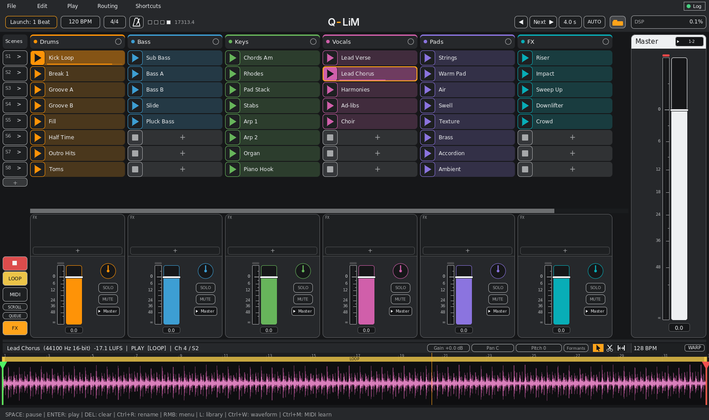
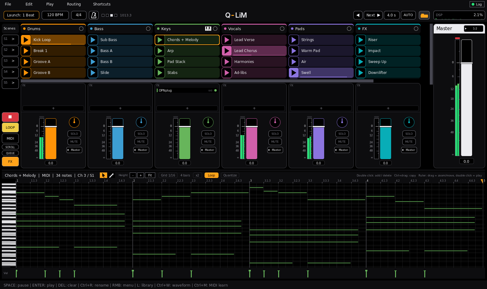
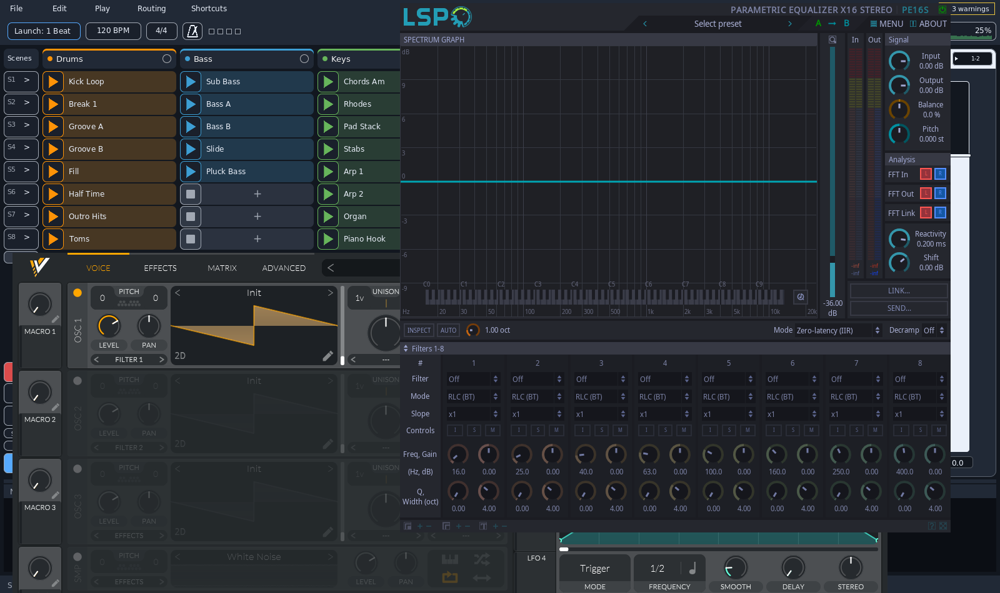
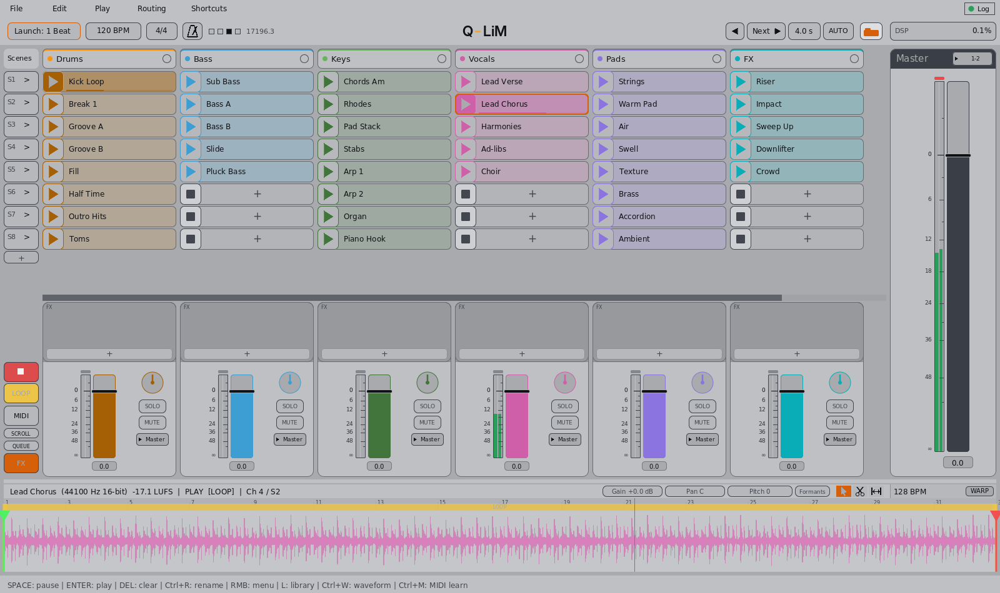
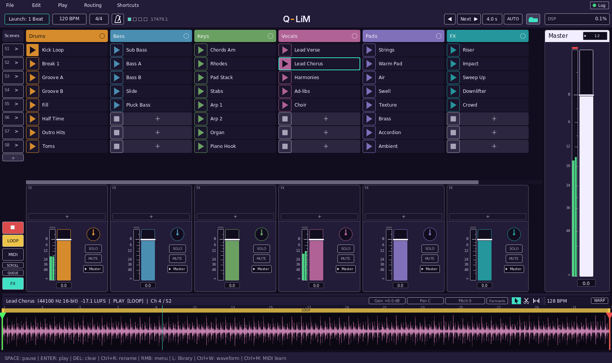

# Q-LiM

**Q-LiM е програма за изпълнения на живо с аудио клипове, за Linux и Windows.** Слагаш клипове в мрежа от канали × сцени и ги пускаш, спираш, въртиш в кръг и миксираш на живо. Работи подобно на изгледа със сесии в Ableton Live или Bitwig. Q-LiM е малка, бърза и свободна програма.



*Темата Graphite в стил Modern: клипове свирят (тънка линия показва докъде е стигнал всеки) и вълната на избрания клип.*

| | |
|---|---|
| [](docs/screenshots/pianoroll.png) | [](docs/screenshots/plugins.png) |
| Темата OLED Black в стил Modern, с MIDI клип в редактора (piano roll) | Прозорци на плъгини (LSP Parametric Equalizer, Vitalium) |
| [](docs/screenshots/light.png) | [](docs/screenshots/classic.png) |
| Светлата тема Paper (спокойно сиво, никога ярко бяло) | Стилът Classic с темата Aurora |

*[Read in English](README.md)* · **[Ръководство](docs/MANUAL.bg.md)**


**Подкрепи Q-LiM** (по желание): Q-LiM е безплатна и ще остане безплатна. Ако ти е полезна, можеш да подкрепиш развитието ѝ през Revolut - [revolut.me/georgiefgj](https://revolut.me/georgiefgj) или сканирай кода. Благодаря!

## Какво може

- **Мрежа с клипове**: до 50 канала и 250 сцени. Пускаш един клип или цяла сцена, а следващия клип може да сложиш на опашка с плавен преход (crossfade). Клиповете могат да се въртят в кръг (loop).
- **Вълната на клипа**: маркери за начало, край и loop. Рязане, копиране и поставяне на части, без да се пипа самият файл.
- **Темпо**: разпознава BPM и сменя темпото без да сменя тона (Rubber Band R3). Главен BPM и бутон **WARP** на всеки клип, който го нагласява по него.
- **Старт в такт** (като в Ableton/Bitwig): клипове и сцени тръгват точно в началото на следващия удар или такт (Now, 1 Beat … 4 Bars).
- **Миксер**:
  - фейдъри, пан, solo и mute;
  - мастер канал;
  - насочване на всеки канал към всеки изход на картата (до 62 изхода).
- **Ефекти и инструменти**: плъгини **VST3, VST2, CLAP** и (на Linux) **LV2**, всеки със своя прозорец. Плъгините се проверяват в отделен процес, а могат и да **работят** в такъв (Edit → Plugins → Safety, като защитата от сривове в Bitwig): плъгин, който се срине или блокира там, млъква за миг и тръгва отново с настройките си, а Q-LiM и другите тракове продължават. Плъгините, които някога са сривали или блокирали Q-LiM, отиват там сами. Така се отварят и LV2 плъгините с Gtk прозорци (напр. Calf).
- **MIDI клипове и редактор (piano roll)**; **.mid** файлове се пускат направо в клетка.
- **Метроном** (бутонът до BPM).
- **Начална папка на библиотеката**: в библиотеката (L) звездата прави текущата папка начална; къщичката те връща в нея.
- **Нормализиране на силата** (Edit → Loudness…): всички клипове с еднаква сила, като в Spotify / YouTube (-14 LUFS), Apple Music (-16) или телевизията (-23); по подразбиране е изключено.
- **Гейн и пан на всеки клип** (като в Bitwig): „Gain“ и „Pan“ над вълновата форма, отделно за всеки клип (влачиш, колелцето на мишката, двоен клик = 0).
- **Тоналност (Pitch) на всеки клип**, без да се променя темпото: „Pitch“ над вълновата форма, от -24 до +24 полутона (влачиш = цели полутонове, `Shift` = центове, колелцето = 1 полутон, `Shift` + колелцето = 10 цента, двоен клик = 0). Тонът е точен (до 0,1 цента), работи заедно с WARP и не товари процесора. **Formants** запазва гласовете естествени (без „катерички“ и „великани“).
- **Разделяне (Separate)** (64-битова версия): десен клик на клип → избираш какво да се отдели: **Vocals, Drums, Bass, Guitar, Piano** (кое да е от тях); останалото стои заедно като „Other“ („Instrumental“, ако е само вокалът), така че всички части винаги дават точно песента. Вокалът - с Mel-Band RoFormer, инструментите - с **BS-RoFormer SW** (най-добър) или **HTDemucs 6s** (по-лек, ~5 пъти по-бърз); с „vocals by Mel-Band RoFormer first“ - двата заедно. Всяка част има свой цвят, сила, **M**ute и **S**olo под вълновата форма (MIDI Learn на силата: десен клик върху нея), **Split to clips** (частите „висят“ на мишката и се пускат в празни клетки една под друга), експорт на всяка част. Всеки модел се сваля веднъж, само когато потрябва, и може да се изтрие пак (File → Separation...: там са и папката, форматът, честотата и заетото място). Работи в отделна програма само когато го пуснеш: Q-LiM остава лека както преди; ако RAM паметта е малко, програмата предупреждава.
- **Съраунд (Surround)** (десен клик на канал): каналът през 4 ... 8 изхода около залата (Quad, 5.0, 5.1, 6 / 8 в кръг, 7.0, 7.1), позиция, ширина и разсейване; клиповете местят звука във времето си (прозорецът Surround, Path: точки в кръга по времевата линия на клипа, влачат се, плавно по късия път). Постоянна мощност (2-D VBAP).
- **Съраунд - режим Room (зала)**: залата отгоре с колоните където са в действителност (готови: Theater (9), Theater (6), Quad); звукът може да минава право през залата, в стерео (лявото към лявата стена, дясното към дясната), по път, нарисуван на плана (точки във времето на клипа, всяка със своя ширина и разсейване). DBAP, постоянна мощност.
- **Speaker Map**: свързваш всеки съраунд сигнал (каналите на файла или колоните на съраунда) с всеки изход на всяка звукова карта, като графата на PipeWire - един сигнал може да отиде към няколко изхода.
- **Запис на живо**: клетката, която записва, има бутон стоп; звукът се рисува, докато се записва, а MIDI се появява в редактора, докато свириш.
- **Моливче в MIDI редактора**: бледа нота показва къде ще сложиш, с дължината на последната.
- **Съраунд файлове**: 5.1 / 7.1 / Quad ... файл свири всеки канал на свой изход (лента за всеки канал във вълната), или става стерео микс с автоматично намерено движение като съраунд точки, които се редактират (оригиналът се пази), или свири като стерео.
- **Съраунд експорт**: клип по своя път или цяла сцена по всички изходи - един многоканален файл (WAV / AIFF / Ogg / Opus, FLAC до 8; 5.1 / 7.1 със стандартната подредба на каналите) или моно файл за всяка колона / изход.
- **Повече от една звукова карта едновременно** (Edit → Sound Cards...): втора карта, изходът за слушалки, Bluetooth колонки - изходите им идват след тези на основната карта (Routing показва всяка карта над нейните изходи), така че каналите, мастерът или съраундът могат да ги ползват. Всеки изход има свое **закъснение** (Routing → ред Delay, 0 ... 2000 ms), за да се изравнят колоните. Часовниците на картите се изравняват сами (качествен ресемплер с бавен регулатор - без отплаване, без щракания); PipeWire, ALSA, JACK и Windows.
- **Експорт на сцена (Export Scene Audio)** (десен клик на сцена): каквото свири сцената, точно както се чува (фейдъри, плъгини, мастер), докато свърши най-дългият клип без лууп - във всеки формат.
- **Преходи между сцените**: **Next** / **◀** горе (или един MIDI бутон) - каквото свири заглъхва, а следващата сцена влиза плавно (equal power), за време, което се сменя там (или с копче); **◀** връща стъпка по стъпка; **AUTO** („Stop automations“) спира всички преходи където са и продължаваш на ръка. Десен клик на сцена: „Fade to This Scene“.
- **Пускане в точен час**: десен клик на клип или сцена → „Launch at Time...“ (напр. 21:30:00): тръгва точно в тази секунда, без квантизация; сцена може да влезе плавно; веднъж или всеки ден; пази се в проекта (File → Launches at a Time... ги показва всички).
- **Експорт на аудио (Export Audio)**: клип от старт до стоп маркера, както звучи (рязане, WARP, pitch, gain, pan) - WAV / AIFF / FLAC / Ogg / Opus / MP3, всяка честота.
- **MIDI Learn за параметрите на плъгините** (VST3, VST2, CLAP, LV2): десен клик на копче или движиш параметъра в прозореца на плъгина, после движиш контрол на MIDI контролера. Пази се в проекта.
- **Всякакъв размер**: 4/4, 3/4, 7/8, 5/4, 12/8 ... - двоен клик на „4/4“ до BPM и го написваш. Квантизацията на пускането (1 Bar, 2 Bars ...), метрономът, номерата на тактовете и пиано рола го следват.
- **Запис**: бутонът ● на канала го подготвя, клик в празна клетка записва звук от картата (или MIDI на инструментален канал); започва и спира в такт, после се върти в такт.
- **Свирене на VST инструменти** от MIDI клавиатура или от клавиатурата на компютъра (`Ctrl+K`, после `A`…`K`). Като маркираш името на канал, долу се показват плъгините му с копчета за настройките (като в Bitwig).
- **MIDI learn** за фейдъри, копчета, бутони и клипове.
- **Няколко MIDI входа наведнъж** (клавиатура, контролер, MIDI входът на звуковата карта ...): цъкаш ги в Edit → MIDI…; всеки може да е за свирене (Play), за управление (Control) или и двете. Запомнят се и се свързват сами, щом ги включиш.
- **Бутони на контролера** за всеки MIDI контролер (Edit → MIDI…): местене на избора с бутони или джог колело (настройва се колко щраквания са една стъпка), пускане / спиране на избрания клип или сцена. Stop all и MUTE на мастера се учат с MIDI learn, като фейдърите.
- **Падовете пускат рамка от клипове** (като session ring в Ableton): избираш размера (напр. 4 канала x 2 сцени за 8 пада) в Edit → MIDI…, натискаш „Learn the pads“ и после падовете, първо горния ред. Рамката (оранжева) се мести с избора - въртиш джог колелото и тя се мести. Всеки пад пуска клипа в своята клетка (празна клетка спира канала); Play пуска сцената на избрания ред, Stop спира каналите в рамката. Над вълновата форма се вижда честотата и битовете на файла.
- **Звук**:
  - **Linux**: директно през **PipeWire** (всеки канал може да е отделен възел за qpwgraph / Patchance) или ALSA / **JACK** през PortAudio (JACK се показва, когато има пуснат JACK сървър - jackd или JACK-а на PipeWire; пакетите не изискват JACK да е инсталиран);
  - **Windows**: WASAPI, **ASIO**, DirectSound, MME или WDM-KS.
- **Файлове**: WAV, AIFF, FLAC, Ogg, Opus и MP3 са вградени. За M4A/AAC трябва `ffmpeg`.
- **Теми** (Edit → Appearance…): 12 теми (Dark, Light, Midnight, Solarized, OLED Black, Nord, Gruvbox, Graphite, Slate, Aurora, Paper, Ember), стил **Classic** или **Modern** (по-заоблен, цветна ивица на заглавията на каналите, клиповете леко оцветени в цвета на канала) и как свирещият клип показва времето си (**брояч**, **линия** или и двете).
- **Стари и слаби компютри**: Edit → Performance (Eco интерфейс, кадри в секунда, лека вълна, "първо звукът"); размерът на интерфейса е в Edit → Appearance (и `Ctrl+колелце`).
- **Сигурност**:
  - Undo/Redo;
  - автоматичен запис всяка минута;
  - възстановяване след срив или спрян ток;
  - запис, при който старият файл никога не остава наполовина презаписан.

## Изтегляне и инсталиране

Готовите версии са в [Releases](../../releases):

| Система | Файл | Инсталиране |
|---|---|---|
| Ubuntu, Linux Mint, Debian | `qlim_2.0.0-2_amd64.deb` | двоен клик или `sudo apt install ./qlim_2.0.0-2_amd64.deb` |
| Fedora, RHEL, openSUSE | `qlim-2.0.0-2.x86_64.rpm` | `sudo dnf install ./qlim-2.0.0-2.x86_64.rpm` |
| Alpine Linux | `qlim_2.0.0-r2_x86_64.apk` | `doas apk add --allow-untrusted qlim_2.0.0-r2_x86_64.apk` |
| Всеки Linux (без инсталиране) | `Q-LiM-2.0.0-x86_64.AppImage` | направи го изпълним и го пусни |
| 32-битов Linux (Debian, Ubuntu, Mint, antiX ...) | `qlim_2.0.0-2_i386.deb` | `sudo apt install ./qlim_2.0.0-2_i386.deb` |
| 32-битов Linux (Fedora, openSUSE ...) | `qlim-2.0.0-2.i386.rpm` | `sudo dnf install ./qlim-2.0.0-2.i386.rpm` |
| 32-битов Alpine | `qlim_2.0.0-r2_x86.apk` | `doas apk add --allow-untrusted qlim_2.0.0-r2_x86.apk` |
| Windows XP, Vista, 7, 8, 10, 11 (32 и 64-битов) | `Q-LiM-2.0.0-Setup-Windows-32bit-64bit.exe` | пусни инсталатора - сам избира правилната версия |
| Windows XP – 11, без инсталиране (portable) | `Q-LiM-2.0.0-Windows-32bit-portable.zip` | разархивирай където искаш (и на флашка) и пусни `qlim.exe` |

Бележки:
- **Linux пакетите** искат по-нова система: Ubuntu 22.04+, Mint 21+, Debian 12+ или Fedora 35+. Нужните библиотеки са вътре в пакета. Каквото липсва, apt, dnf или apk го слагат автоматично.
- **AppImage** не слага Q-LiM в менюто. За това е .deb/.rpm пакетът.
- **Windows** може да предупреди за "непознат издател", защото инсталаторът не е подписан с платен сертификат. Натисни "More info" → "Run anyway".
- **Windows 11: "qlim.exe - Bad Image ... libunwind.dll (или друг .dll) is either not designed to run on Windows or it contains an error ... 0xc0e90002"**. Файлът не е повреден: **Интелигентният контрол на приложенията** (Smart App Control) в Windows 11 спира програми и DLL-и, които не са подписани с платен сертификат (Q-LiM е безплатна и засега не е подписана). За да тръгне Q-LiM, изключи го:
  1. Старт → напиши **„Интелигентен контрол“** (или *Защита на Windows → Контрол на приложения и браузъри → Настройки за интелигентния контрол на приложенията*).
  2. Избери **Изкл.**

  Внимание: след изключване Windows не позволява да се включи пак без преинсталиране. Антивирусата (Microsoft Defender) остава включена.
- **ASIO драйверът** идва от производителя на звуковата карта (или ASIO4ALL). Q-LiM само го ползва и не инсталира нищо.

## На какво е тествана

Q-LiM е направена да работи добре на всеки компютър - от лаптоп от 2006 г. до нов студиен компютър. Преди всяка версия минава през:

**Автоматични тестове** (над 40 тестови програми, `tests/`): звуковият двигател бит по бит (клип на 0 dB звучи точно като файла), смяната на честотата, преливанията, опашката, тактовото пускане, темпото и WARP, тоналността, рязането и Undo, записа, MIDI клиповете и MIDI learn, силата на звука, износа (всички формати, съраунд), запазването и отварянето на проекти, „Collect All“, разделянето на части, маршрутизацията и плъгините - включително плъгини, които **нарочно се сриват или замръзват** в отделния процес (Q-LiM трябва да продължи да свири). Освен това: **fuzz тестове** (хиляди случайни действия и развалени проекти, с AddressSanitizer и ThreadSanitizer), тестове за състезание между звуковата нишка и интерфейса, случайни кликове по интерфейса и дълги тестове за паметта.

**Истински плъгини**: Vitalium, Odin2, Tunefish4, ChowKick, OPNplug и 30 LSP плъгина (еквалайзери, миксери до 34 входа, семплер с 98 изхода) - като VST3, LV2 и CLAP, вътре в Q-LiM и в отделен процес.

**Истински компютри**:

| Компютър | Система | Бележка |
|---|---|---|
| **Lenovo ThinkPad T60 (2006)** - Intel Core 2 Duo, ATI Radeon X1400 | Alpine Linux 64-битов | **най-слабият**: Q-LiM ползва около 1,5 % от процесора в покой и 5-6 % с пет свирещи клипа |
| Lenovo ThinkCentre M920x | Linux Mint | основният компютър за разработка |
| VirtualBox | Windows XP, Windows 7, Windows 11 | инсталиране и всекидневна работа, тествано от автора |
| Wine (Linux) | Windows 64-битов и 32-битов (XP режим) | тестовете на отделния процес за плъгини под Windows |

### Стари видеокарти и USB звукови карти (Linux)

На някои по-стари лаптопи звукът на **USB звукова карта** пука или пращи, докато картината на екрана се сменя - във **всяка** програма, не само в Q-LiM. Открихме причината на ThinkPad T60: видеокартата (ATI Radeon X1400) прехвърля данни за картината по общата шина на компютъра толкова натоварено, че равномерният поток звук към USB картата се прекъсва за миг. Вградените звукови карти нямат този проблем, а по-голям буфер не помага, защото не процесорът е причината.

Q-LiM дава две решения:

1. **Edit → Performance → „Gentle on the graphics card (old laptops with USB sound)“**: Q-LiM праща картината към видеокартата на малки части. Пробвай първо това.
2. **Системната поправка** (Linux с X11): `sh /opt/qlim/qlim-old-gpu-fix.sh on`, после излез и влез отново. Тя изключва 2D ускорението на видеокартата (тогава процесорът рисува картината и се натоварва малко повече) и на T60 пукането спря напълно. `sh /opt/qlim/qlim-old-gpu-fix.sh off` връща всичко, `status` показва дали е включена. Пише само един файл (`/etc/X11/xorg.conf.d/20-qlim-no-accel.conf`), не прави нищо под Wayland и отказва да работи с драйвера на NVIDIA.

## Качество на звука

Q-LiM не променя звука, освен ако ти не го поискаш:

- **Нормализирането на силата** е изключено по подразбиране; включено (Edit → Loudness…) то само сменя силата на всеки клип, не и самия звук, и никога не вдига клип над -1 dBFS.
- Всичко се обработва в **32-битово плаваща запетая**, от файла до звуковата карта. Фейдър на 0 dB и пан в средата са точно 1.0, така че клипът звучи **бит по бит както е във файла**. Няма компресия, лимитер или нормализиране.
- **Честота (sample rate):** ако файлът е с честотата на звуковата карта (Edit → Audio…), той не се пипа. Ако е различна, се преобразува с много качествен конвертор: равен от 0 до 20 kHz (в рамките на 0.01 dB), а всичко останало е поне 128 dB под музиката. За звук „бит по бит“ сложи в Edit → Audio… честотата на файловете си (повечето музика е 44100 Hz).
- **MP3:** декодира се веднъж в 32-битов float WAV в кеша (нищо не се губи). Повредени кадри или кадри, записани грешно от някои енкодери, се декодират възможно най-добре, вместо да оставят дупка от тишина.
- **Warp** (разтягане по темпо) неизбежно променя звука. Изключи го за клипове, които вече са в темпото на проекта.
- Над 0 dB на мастера звукът се реже на изхода. Червената лампа CLIP показва това.
- С PipeWire Q-LiM кара PipeWire да върви на честотата от Edit → Audio…: разрешава я и ако PipeWire пак не превключи, го държи на нея, докато Q-LiM работи (`clock.force-rate`; старата стойност се връща при затваряне - ако Q-LiM някога крашне, `pw-metadata -n settings 0 clock.force-rate 0` или излизане от системата я връщат). Ако звуковата карта не може тази честота, Q-LiM минава на честотата на PipeWire и ти казва. За да е разрешена завинаги: `~/.config/pipewire/pipewire.conf.d/rates.conf` със `context.properties = { default.clock.allowed-rates = [ 44100 48000 88200 96000 ] }`.
- След Q-LiM операционната система може пак да преобразува звука (PipeWire/PulseAudio, миксерът на Windows). За най-чист път ползвай ASIO под Windows или звукова карта, настроена на същата честота.

## Компилиране

На Linux (Ubuntu / Mint / Debian):

```sh
sudo apt install build-essential pkg-config libsdl2-dev libsdl2-ttf-dev portaudio19-dev \
                 libsndfile1-dev librtmidi-dev libx11-dev
mv Makefile.linux Makefile     # веднъж: файлът е записан като Makefile.linux - преименувай го
make
./qlim
```

**Важно:** Linux make-файловете са записани като `Makefile.linux` (в главната папка и в `tests/`). Преди компилиране
ги преименувай на `Makefile`, или ги остави и пиши `make -f Makefile.linux` вместо `make`.

Пакетите (.deb, .rpm, .apk, AppImage) и Windows версията се правят с `packaging/Makefile.pkg` и `Makefile.win` -
подробностите са в [README.md](README.md#building-from-source) на английски.

## Лиценз

Q-LiM е свободен софтуер под **GNU General Public License, версия 3 или по-нова**. Виж [LICENSE](LICENSE) и [THIRD_PARTY.md](THIRD_PARTY.md).

Copyright © 2026 Георги Станимиров Иванов (Georgi Stanimirov Ivanov, [GeorgeArtAcc](https://github.com/GeorgeArtAcc)).
