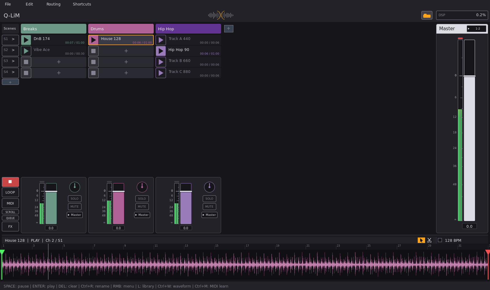

# Q-LiM

**Q-LiM is a live clip launcher for Linux and Windows.** You put audio clips into a grid of channels × scenes and start, stop, loop and mix them live. The workflow is close to the session view of Ableton Live or Bitwig, but Q-LiM is small, fast and free software.



*[Прочети на български](README.bg.md)*

## Features

- **Clip grid**: up to 50 channels and 250 scenes. You can start one clip or a whole scene, or queue the next clip with a crossfade. Clips can loop, scenes can be renamed and channels can be coloured.
- **Waveform editor** with start, end and loop markers. Cutting, copying and pasting parts of a clip is non-destructive (the audio file is never changed).
- **Tempo**: BPM detection, plus time-stretching with **Rubber Band R3**, which changes the tempo without changing the pitch. A master BPM, and a **WARP** button per clip that fits the clip to it.
- **Launch quantization** (like Ableton/Bitwig): clips and scenes start exactly on the next beat or bar (Now, 1 Beat … 4 Bars).
- **Mixer**:
  - faders, pan, solo and mute;
  - a master channel and level meters;
  - routing of each channel to any output of the sound card (up to 62 outputs).
- **Effects and instruments**: hosts **VST3, VST2, CLAP** and (on Linux) **LV2** plugins, each with its own window. Plugins are scanned in a separate process, so a crashing plugin cannot take Q-LiM down.
- **MIDI clips and a piano-roll editor**; **.mid** files can be dropped onto cells.
- **Metronome** (the button next to the BPM).
- **Recording**: arm a channel (●), click an empty cell to record audio from the sound card (or MIDI on an instrument channel); start and stop on the bar, then it loops in time.
- **Play VST instruments** from a MIDI keyboard or the computer keyboard. Click a channel name and its plugins appear below with knobs for their settings (like Bitwig's device panel).
- **MIDI learn** for faders, knobs, buttons and clips, using notes or CC messages.
- **Audio**:
  - **Linux**: ALSA/JACK through PortAudio, or native **PipeWire** output. With PipeWire, every channel can be its own node in the graph, ready for qpwgraph or Patchance.
  - **Windows**: WASAPI, **ASIO**, DirectSound, MME or WDM-KS.
- **Files**:
  - WAV, AIFF, FLAC, Ogg Vorbis, Opus and MP3 are built in;
  - M4A/AAC and other formats work through `ffmpeg` if it is installed;
  - there is a file library with drag & drop.
- **Safety**: undo/redo, autosave every minute, recovery after a crash or power cut, and safe saving (an old project file is never half-overwritten).
- **Themes** (Appearance dialog) and a full keyboard shortcut list (Shortcuts menu).

## Download

Ready-made builds are on the [Releases](../../releases) page:

| System | File | Install |
|---|---|---|
| Ubuntu, Linux Mint, Debian | `qlim_<version>-1_amd64.deb` | `sudo apt install ./qlim_<version>-1_amd64.deb` (or double-click it) |
| Fedora, RHEL, openSUSE | `qlim-<version>-1.x86_64.rpm` | `sudo dnf install ./qlim-<version>-1.x86_64.rpm` |
| Alpine Linux | `qlim_<version>-r1_x86_64.apk` | `sudo apk add --allow-untrusted qlim_<version>-r1_x86_64.apk` |
| Any Linux (no install) | `Q-LiM-<version>-x86_64.AppImage` | make it executable, then run it |
| Windows 7 SP1 – 11 (64-bit) | `Q-LiM-Setup-<version>.exe` | run the installer |

Notes:
- **Linux packages** need glibc 2.34 or newer (Ubuntu 22.04+, Mint 21+, Debian 12+, Fedora 35+). The libraries Q-LiM needs are built in. The few that every desktop already has (ALSA, X11) are installed automatically by apt, dnf or apk.
- **The AppImage** does not add Q-LiM to the menu and does not open `.limproject` files by double-click. Use the `.deb`/`.rpm` package for that, or a tool such as AppImageLauncher.
- **Windows** may warn that the installer comes from an unknown publisher, because it is not signed with a paid certificate. Click "More info" → "Run anyway".
- **ASIO on Windows**: the ASIO driver itself comes from your sound card's maker (Focusrite, Behringer…) or from ASIO4ALL. Q-LiM only uses it; it does not install anything.

## Building from source

### Linux (for development)

```sh
# Debian / Ubuntu / Mint
sudo apt install build-essential pkg-config libsdl2-dev libsdl2-ttf-dev portaudio19-dev \
                 libsndfile1-dev librtmidi-dev libx11-dev
mv Makefile.linux Makefile     # once (see the note below)
make            # builds ./qlim and adds a menu entry + file icon for your user
./qlim
```

The build works the same way on other distributions with the same libraries (SDL2 ≥ 2.0.18). Notes:
- **About the Makefile names:** the Linux makefiles are stored as `Makefile.linux` (in the main folder and in `tests/`).
  Rename them to `Makefile` before building, or keep the names and use `make -f Makefile.linux` instead of `make`.
  The other makefiles are used with `-f` as they are: `Makefile.win`, `packaging/Makefile.pkg`, `tests-win/Makefile.win`.
- `make uninstall-icon` removes the menu entry again.
- PipeWire and liblilv are optional: they are loaded at run time if they are present.

### Linux packages (.deb, .rpm, .apk, AppImage)

The release packages are self-contained: SDL2, FreeType, HarfBuzz, libsndfile with its codecs, PortAudio and RtMidi are compiled in statically. Everything is fetched from GitHub:

```sh
sh packaging/fetch-sources.sh              # sources, nfpm, musl toolchain, appimagetool -> /opt/lnx
sh packaging/build-deps.sh gnu             # static libraries for glibc
make -f packaging/Makefile.pkg T=gnu packages appimage   # .deb + .rpm + AppImage
sh packaging/make-x11-stubs.sh && sh packaging/build-deps.sh musl
make -f packaging/Makefile.pkg T=musl packages           # .apk (Alpine)
```

### Windows (cross-compiled on Linux)

The Windows build is made on Linux with [llvm-mingw](https://github.com/mstorsjo/llvm-mingw). The installer is built with Inno Setup, running under Wine.

```sh
sh tools/setup-win-toolchain.sh            # compiler, libraries, Wine, Inno Setup, ASIO SDK -> /opt/win
make -f Makefile.win installer             # build-win/Q-LiM-Setup-<version>.exe
```

ASIO support needs the free [Steinberg ASIO SDK](https://www.steinberg.net/developers/asiosdk-open/), which Q-LiM uses under its GPLv3 option. The setup script downloads it and checks it by SHA-256. If the download is blocked, put `ASIO-SDK_2.3.4_2025-10-15.zip` into `/opt/win/asiosdk.zip` yourself.

The Windows-specific code is in `src/win/` (UTF-8 file names, native dialogs, plugin windows, process handling). The rest of the source is shared with Linux, using a few `#ifdef _WIN32` blocks.

### Tests

```sh
cd tests && make -f Makefile.linux test     # engine, editing, crossfade, tempo, fuzzing and race tests
cd tests-win && make -f Makefile.win tests   # Windows builds of some of them (run under Wine or on Windows)
```

## Using Q-LiM

- **Load clips** by dragging audio files onto a cell (from the built-in library `L` or from your file manager). Start a clip with its ▶ button, or a whole scene with the scene button.
- **Show the waveform** of the selected clip with `Ctrl+W`. You can set the start, end and loop markers there and cut, copy and paste parts of the clip.
- **Add effects**: open the FX strip with the `FX` button, then press `+`. Double-click a plugin to open its window.
- **MIDI clips**: on an instrument channel, double-click an empty cell; the piano roll opens below (double-click = add / delete a note; drag on the ruler = zoom / move, double-click on the ruler = play from there; Ctrl+drag = copy, Ctrl+C / Ctrl+V notes, Ctrl+U = quantize).
- **Record**: click ● on a channel header to arm it, then the red circle in an empty cell (right-click ● for the input and monitoring).
- **Play an instrument**: click a channel name, press `+` in the panel below and pick a plugin marked `INST`. The MIDI keyboard plays the selected instrument channel. No MIDI keyboard? Press `Ctrl+K` and play with `A`…`K` (`Z`/`X` = octave).
- **Settings**: Edit → Audio… for the sound card and Edit → MIDI… for controllers. Press `Ctrl+M` to start MIDI learn.
- **Shortcuts**: the Shortcuts menu shows all of them.

Settings, the log and autosaves are kept in `~/.config/qlim/` (on Windows: `C:\Users\<name>\.config\qlim\`). If something goes wrong, `qlim.log` there is the most useful thing to attach to an issue.

## Project layout

```
src/            the program (C11; C++ only for RtMidi and VST3)
src/win/        Windows-only code
third_party/    bundled headers and Rubber Band (see third_party/README.md)
packaging/      Linux packages and AppImage
installer/      Windows installer (Inno Setup)
tools/          icon generator, release archive, Windows toolchain setup
tests/          tests (Linux); tests-win/ - tests for the Windows build
assets/         font and icons
```

## License

Q-LiM is free software: you can redistribute it and/or modify it under the terms of the **GNU General Public License, version 3 or (at your option) any later version**. See [LICENSE](LICENSE).

Copyright © 2026 Georgi Stanimirov Ivanov ([GeorgeArtAcc](https://github.com/GeorgeArtAcc)).

Q-LiM uses or contains code from other projects; see [THIRD_PARTY.md](THIRD_PARTY.md). VST is a registered trademark and ASIO is a trademark of Steinberg Media Technologies GmbH.
