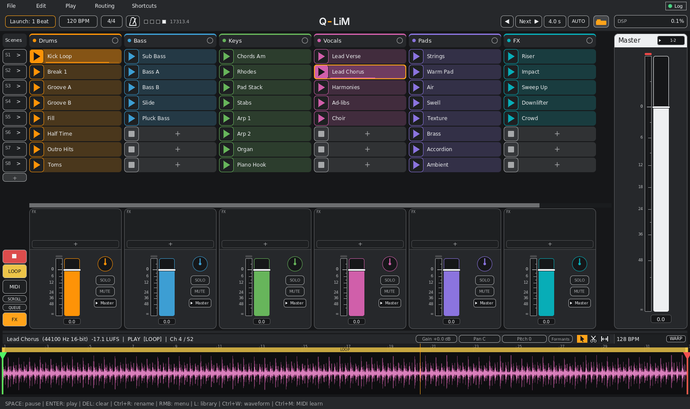
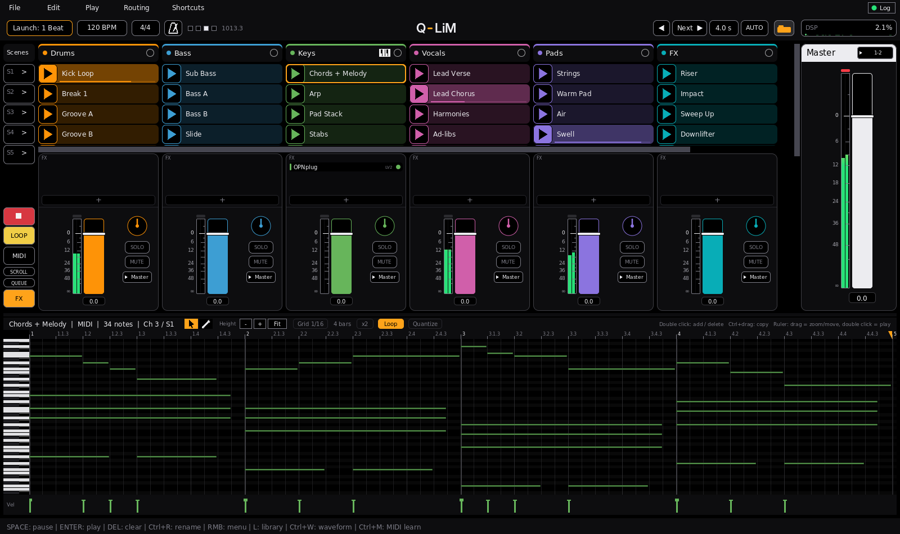
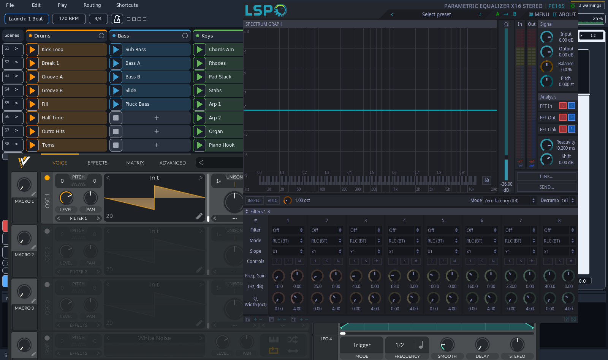
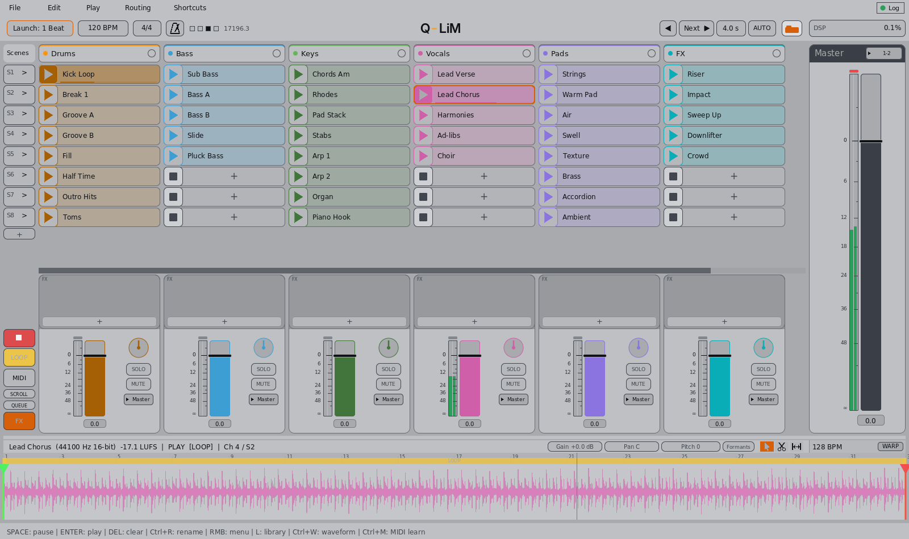
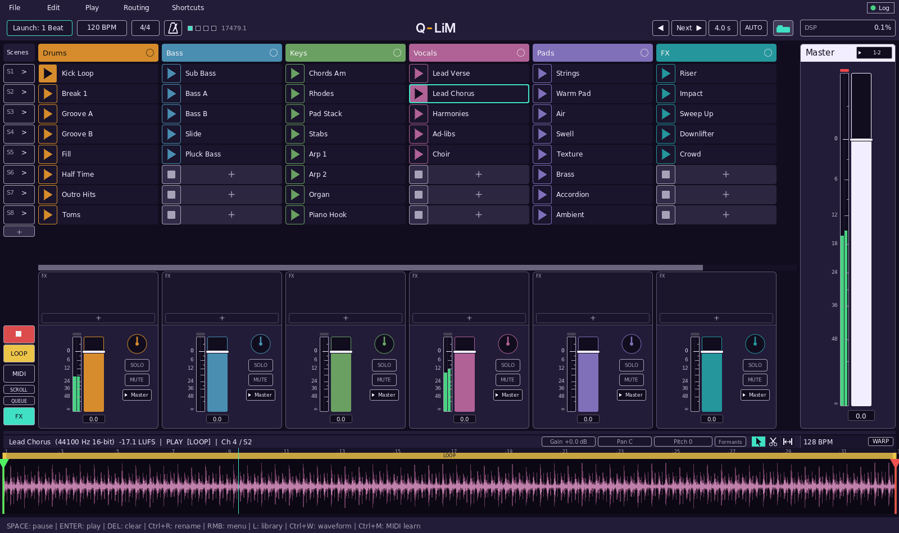

# Q-LiM

**Q-LiM is a live clip launcher for Linux and Windows.** You put audio clips into a grid of channels × scenes and start, stop, loop and mix them live. The workflow is close to the session view of Ableton Live or Bitwig, but Q-LiM is small, fast and free software.



*The Graphite theme in the Modern style: clips playing (a thin line shows how far each one is) and the waveform of the selected clip.*

| | |
|---|---|
| [](docs/screenshots/pianoroll.png) | [](docs/screenshots/plugins.png) |
| The OLED Black theme in the Modern style, with a MIDI clip in the piano roll | Plugin windows (LSP Parametric Equalizer, Vitalium) |
| [](docs/screenshots/light.png) | [](docs/screenshots/classic.png) |
| The light Paper theme (a calm grey, never bright white) | The Classic style with the Aurora theme |

*[Прочети на български](README.bg.md)* · **[User Manual](docs/MANUAL.md)**


**Support Q-LiM** (optional): Q-LiM is free and will stay free. If it is useful to you, you can support its development on Revolut - [revolut.me/georgiefgj](https://revolut.me/georgiefgj) or scan the code. Thank you!

## Features

- **Clip grid**: up to 50 channels and 250 scenes. You can start one clip or a whole scene, or queue the next clip with a crossfade. Clips can loop, scenes can be renamed and channels can be coloured.
- **Waveform editor** with start, end and loop markers. Cutting, copying and pasting parts of a clip is non-destructive (the audio file is never changed).
- **Tempo**: BPM detection, plus time-stretching with **Rubber Band R3**, which changes the tempo without changing the pitch. A master BPM, and a **WARP** button per clip that fits the clip to it.
- **Launch quantization** (like Ableton/Bitwig): clips and scenes start exactly on the next beat or bar (Now, 1 Beat … 4 Bars).
- **Mixer**:
  - faders, pan, solo and mute;
  - a master channel and level meters;
  - routing of each channel to any output of the sound card (up to 62 outputs).
- **Effects and instruments**: hosts **VST3, VST2, CLAP** and (on Linux) **LV2** plugins, each with its own window. Plugins are scanned in a separate process, and they can also **run** in one (Edit → Plugins → Safety, like Bitwig's crash protection): a plugin that crashes or freezes there goes silent for a moment and is started again with its settings, while Q-LiM and the other tracks play on. Plugins that ever crashed or froze Q-LiM go there by themselves. LV2 plugins with Gtk windows (e.g. Calf) open this way too.
- **MIDI clips and a piano-roll editor**; **.mid** files can be dropped onto cells.
- **Metronome** (the button next to the BPM).
- **Library start folder**: in the library (L), the star button makes the current folder the start folder; the house button goes back to it.
- **Loudness normalization** (Edit → Loudness…): every clip at the same loudness, like Spotify / YouTube (-14 LUFS), Apple Music (-16) or TV (-23); off by default.
- **Clip gain and pan** (like Bitwig): "Gain" and "Pan" above the waveform, for every clip on its own (drag, mouse wheel, double click = 0).
- **Clip pitch** without changing the speed: "Pitch" above the waveform, -24…+24 semitones (drag = whole semitones, `Shift` = cents, mouse wheel = 1 semitone, `Shift` + wheel = 10 cents, double click = 0). The note is exact (to 0.1 cent), works together with WARP, and is light on the CPU. **Formants** keeps voices natural (no "chipmunk" or "giant" voice).
- **Separate** (64-bit): right click a clip → choose what to take out: **Vocals, Drums, Bass, Guitar, Piano** (any of them); the rest stays together as "Other" ("Instrumental" with only the vocals), so all the parts always add up to the song exactly. Vocals by Mel-Band RoFormer, the instruments by **BS-RoFormer SW** (best) or **HTDemucs 6s** (lighter, ~5x faster); with "vocals by Mel-Band RoFormer first" both together. Every part gets its own colour, level, **M**ute and **S**olo under the waveform (MIDI Learn on the level: right click it), **Split to clips** (the parts hang on the mouse and go into empty cells one under another), export of any part. Each model is downloaded once, only when it is needed, and can be removed again (File → Separation...: also the folder, format, sample rate and space used). Runs in a separate program only when asked: Q-LiM itself stays as light as before; a warning comes when the computer has too little RAM.
- **Surround** (right click a channel): the channel through 4 ... 8 outputs around the room (Quad, 5.0, 5.1, 6 / 8 in a ring, 7.0, 7.1), its position, width and spread; the clips move the sound over their time (the Surround window, Path: points in the circle on the clip's timeline, dragged, smooth the short way round). Constant power (2-D VBAP).
- **Surround - Room mode**: the hall from above with the speakers where they really stand (ready: Theater (9), Theater (6), Quad); the sound can walk straight through the hall, in stereo (left towards the left wall, right towards the right one), along a path drawn on the plan (points in the clip's time, each with its width and spread). DBAP panning, constant power.
- **Speaker Map**: wire every surround signal (a file's channels or the surround speakers) to any output of any sound card, like the PipeWire graph - one signal can go to several outputs.
- **Live recording view**: the recording cell has a stop button; the audio is drawn as it is recorded, MIDI appears in the editor as you play.
- **MIDI pencil**: a pale note shows where a click puts one, as long as the last note.
- **Surround files**: a 5.1 / 7.1 / Quad ... file plays every channel on its own output (a lane per channel in the waveform), or becomes a stereo mix with the movement found automatically as editable surround points (the original is kept), or plays as stereo.
- **Surround export**: a clip through its path or a whole scene on every output - one multichannel file (WAV / AIFF / Ogg / Opus, FLAC up to 8; 5.1 / 7.1 with the standard channel layout) or a mono file per speaker / output.
- **More than one sound card at the same time** (Edit → Sound Cards...): a second card, the headphone output, Bluetooth speakers - their outputs come after the main card's (Routing shows every card over its outputs), so channels, the master or a surround setup can use them. Every output has its own **delay** (Routing → Delay row, 0 ... 2000 ms) to line the speakers up. The cards' clocks are matched automatically (a quality resampler with a slow controller - no drift, no clicks); PipeWire, ALSA, JACK and Windows.
- **Export Scene Audio** (right click a scene): what the scene plays, exactly as heard (faders, plugins, master), until its longest clip without loop ends - any format.
- **Scene transitions**: **Next** / **◀** in the top bar (or one MIDI button) fades out what plays and fades in the next scene (equal power), over a time you set there (or with a knob); **◀** goes back step by step; **AUTO** (“Stop automations”) holds every fade where it is, so you can go on by hand. Right click a scene: “Fade to This Scene”.
- **Launch at a clock time**: right click a clip or a scene → “Launch at Time...” (e.g. 21:30:00): it starts on that second, not quantized; a scene can fade in; once or every day; kept in the project (File → Launches at a Time... lists them all).
- **Export Audio**: a clip from its start to its stop marker, the way it sounds (cuts, WARP, pitch, gain, pan) - WAV / AIFF / FLAC / Ogg / Opus / MP3, any sample rate.
- **MIDI Learn for plugin parameters** (VST3, VST2, CLAP, LV2): right click a knob, or move the parameter in the plugin's window, then move a control on your MIDI controller. Saved in the project.
- **Any time signature**: 4/4, 3/4, 7/8, 5/4, 12/8 ... - double-click the "4/4" next to the BPM and type it. The launch quantization (1 Bar, 2 Bars ...), the metronome, the bar numbers and the piano roll follow it.
- **Recording**: arm a channel (●), click an empty cell to record audio from the sound card (or MIDI on an instrument channel); start and stop on the bar, then it loops in time.
- **Play VST instruments** from a MIDI keyboard or the computer keyboard. Click a channel name and its plugins appear below with knobs for their settings (like Bitwig's device panel).
- **MIDI learn** for faders, knobs, buttons and clips, using notes or CC messages.
- **Several MIDI inputs at once** (keyboard, controller, the sound card's MIDI in ...): click them in Edit → MIDI…; each one can be for playing, for control or both. They are remembered and connect by themselves when plugged in.
- **Controller buttons** for any MIDI controller (Edit → MIDI…): move the selection with buttons or a jog wheel (adjustable: clicks per step), launch / stop the selected clip or scene. Stop all and the master MUTE are learned with MIDI learn, like the faders.
- **Pads play a box of clips** (like the session ring in Ableton): choose the size (e.g. 4 channels x 2 scenes for 8 pads) in Edit → MIDI…, press "Learn the pads" and then the pads, top row first. The box (an orange frame) moves with the selection - turn the jog wheel to move it. Each pad plays the clip in its cell (an empty cell stops that channel); the Play button plays the scene of the selected row, Stop stops the channels of the box. The file's sample rate and bit depth are shown above the waveform.
- **Audio**:
  - **Linux**: native **PipeWire** output (every channel can be its own node in the graph, ready for qpwgraph or Patchance), or ALSA / **JACK** through PortAudio (JACK is offered when a JACK server is running - jackd or PipeWire's JACK; the packages do not need JACK to be installed).
  - **Windows**: WASAPI, **ASIO**, DirectSound, MME or WDM-KS.
- **Files**:
  - WAV, AIFF, FLAC, Ogg Vorbis, Opus and MP3 are built in;
  - M4A/AAC and other formats work through `ffmpeg` if it is installed;
  - there is a file library with drag & drop.
- **Safety**: undo/redo, autosave every minute, recovery after a crash or power cut, and safe saving (an old project file is never half-overwritten).
- **Themes** (Edit → Appearance…): 12 themes (Dark, Light, Midnight, Solarized, OLED Black, Nord, Gruvbox, Graphite, Slate, Aurora, Paper, Ember), the **Classic** or **Modern** style (rounder, a colour strip on the channel headers, clips tinted in their channel's colour) and how a playing clip shows its time (**counter**, a **progress line** or both). A full keyboard shortcut list is in the Shortcuts menu.

## Download

Ready-made builds are on the [Releases](../../releases) page:

| System | File | Install |
|---|---|---|
| Ubuntu, Linux Mint, Debian | `qlim_2.0.0-2_amd64.deb` | `sudo apt install ./qlim_2.0.0-2_amd64.deb` (or double-click it) |
| Fedora, RHEL, openSUSE | `qlim-2.0.0-2.x86_64.rpm` | `sudo dnf install ./qlim-2.0.0-2.x86_64.rpm` |
| Alpine Linux | `qlim_2.0.0-r2_x86_64.apk` | `doas apk add --allow-untrusted qlim_2.0.0-r2_x86_64.apk` |
| Any Linux (no install) | `Q-LiM-2.0.0-x86_64.AppImage` | make it executable, then run it |
| 32-bit Linux (Debian, Ubuntu, Mint, antiX ...) | `qlim_2.0.0-2_i386.deb` | `sudo apt install ./qlim_2.0.0-2_i386.deb` |
| 32-bit Linux (Fedora, openSUSE ...) | `qlim-2.0.0-2.i386.rpm` | `sudo dnf install ./qlim-2.0.0-2.i386.rpm` |
| 32-bit Alpine | `qlim_2.0.0-r2_x86.apk` | `doas apk add --allow-untrusted qlim_2.0.0-r2_x86.apk` |
| Windows XP, Vista, 7, 8, 10, 11 (32 and 64-bit) | `Q-LiM-2.0.0-Setup-Windows-32bit-64bit.exe` | run the installer - it picks the right version itself |
| Windows XP – 11, no install (portable) | `Q-LiM-2.0.0-Windows-32bit-portable.zip` | unzip anywhere (also a USB stick), run `qlim.exe` |

Notes:
- **Linux packages** need glibc 2.34 or newer (Ubuntu 22.04+, Mint 21+, Debian 12+, Fedora 35+). **The 32-bit ones** need only glibc 2.17 (2012) and run on old processors too (no SSE2 needed). The libraries Q-LiM needs are built in. The few that every desktop already has (ALSA, X11) are installed automatically by apt, dnf or apk.
- **The AppImage** does not add Q-LiM to the menu and does not open `.limproject` files by double-click. Use the `.deb`/`.rpm` package for that, or a tool such as AppImageLauncher.
- **Windows**: on 64-bit Windows 7 and newer the installer puts in the 64-bit Q-LiM; on XP, Vista and every 32-bit Windows the 32-bit one (all built into one `qlim.exe`, with ASIO, DirectSound and MME). The 32-bit Windows version needs a processor with SSE2 (Pentium 4, Athlon 64 or newer).
- **Windows** may warn that the installer comes from an unknown publisher, because it is not signed with a paid certificate. Click "More info" → "Run anyway".
- **Windows 11: "qlim.exe - Bad Image ... libunwind.dll (or another .dll) is either not designed to run on Windows or it contains an error ... 0xc0e90002"**. The file is not broken: Windows 11 **Smart App Control** blocks programs and DLLs that are not signed with a paid certificate (Q-LiM is free and not signed yet). To run Q-LiM, turn it off:
  1. Start → type **Smart App Control** (or open *Windows Security → App & browser control → Smart App Control settings*).
  2. Set it to **Off**.

  Note: Windows does not let you turn Smart App Control on again without reinstalling Windows. Your antivirus (Microsoft Defender) stays on.
- **ASIO on Windows**: the ASIO driver itself comes from your sound card's maker (Focusrite, Behringer…) or from ASIO4ALL. Q-LiM only uses it; it does not install anything.

## Tested on

Q-LiM is made to run well on any computer, from a laptop of 2006 to a new studio PC. Before every release it goes through:

**Automated tests** (more than 40 test programs, `tests/`): the audio engine bit for bit (a clip at 0 dB plays exactly as the file), sample-rate conversion, crossfades, the queue, launch quantization, tempo and WARP, pitch, cutting and undo, recording, MIDI clips and MIDI learn, loudness, export (all formats, surround), project save and load, "Collect All", stem separation, routing, and the plugin host - including plugins that **crash or freeze on purpose** inside the separate-process sandbox (Q-LiM must keep playing). On top of that: **fuzz tests** (thousands of random actions and broken project files, with AddressSanitizer and ThreadSanitizer), **race tests** between the audio and the interface threads, random-click **GUI tests**, and long **soak tests** for memory.

**Real plugins**: Vitalium, Odin2, Tunefish4, ChowKick, OPNplug and 30 LSP plugins (equalizers, mixers with up to 34 inputs, a sampler with 98 outputs) - as VST3, LV2 and CLAP, inside Q-LiM and in a separate process.

**Real computers**:

| Computer | System | Note |
|---|---|---|
| **Lenovo ThinkPad T60 (2006)** - Intel Core 2 Duo, ATI Radeon X1400 | Alpine Linux 64-bit | **the weakest one**: Q-LiM uses about 1.5 % of the CPU when idle and 5-6 % with five clips playing |
| Lenovo ThinkCentre M920x | Linux Mint | the main development machine |
| VirtualBox | Windows XP, Windows 7, Windows 11 | installing and everyday use, tested by the author |
| Wine (Linux) | Windows 64-bit and 32-bit (XP mode) | the Windows plugin sandbox tests |

### Old graphics cards and USB sound cards (Linux)

On some older laptops the sound of a **USB sound card** clicks or crackles while the picture on the screen changes - in **every** program, not only in Q-LiM. We found the cause on the ThinkPad T60: the graphics card (ATI Radeon X1400) moves picture data over the computer's shared bus so heavily that the USB card's steady stream of sound is interrupted for a moment. Built-in sound cards are not affected, and a bigger audio buffer does not help, because the problem is not the processor.

Q-LiM gives two remedies:

1. **Edit → Performance → "Gentle on the graphics card (old laptops with USB sound)"**: Q-LiM sends its picture to the graphics card in small pieces. Try this first.
2. **The system fix** (Linux with X11): `sh /opt/qlim/qlim-old-gpu-fix.sh on`, then log out and in. It turns off the graphics card's 2D acceleration (the picture is then drawn by the processor, which uses a little more CPU), and that stopped the clicks completely on the T60. `sh /opt/qlim/qlim-old-gpu-fix.sh off` undoes it, `status` shows if it is on. It writes a single file (`/etc/X11/xorg.conf.d/20-qlim-no-accel.conf`), does nothing on Wayland, and refuses to run with the NVIDIA driver.

## Building from source

### Linux (for development)

```sh
# Debian / Ubuntu / Mint
sudo apt install build-essential pkg-config libsdl2-dev libsdl2-ttf-dev portaudio19-dev \
                 libsndfile1-dev librtmidi-dev libx11-dev
mv Makefile.linux Makefile     # once (see the note below)
make            # builds ./qlim and adds a menu entry + file icon for your user
./qlim
```

The build works the same way on other distributions with the same libraries (SDL2 ≥ 2.0.18). Notes:
- **About the Makefile names:** the Linux makefiles are stored as `Makefile.linux` (in the main folder and in `tests/`).
  Rename them to `Makefile` before building, or keep the names and use `make -f Makefile.linux` instead of `make`.
  The other makefiles are used with `-f` as they are: `Makefile.win`, `packaging/Makefile.pkg`, `tests-win/Makefile.win`.
- `make uninstall-icon` removes the menu entry again.
- PipeWire and liblilv are optional: they are loaded at run time if they are present.

### Linux packages (.deb, .rpm, .apk, AppImage)

The release packages are self-contained: SDL2, FreeType, HarfBuzz, libsndfile with its codecs, PortAudio and RtMidi are compiled in statically. Everything is fetched from GitHub:

```sh
sh packaging/fetch-sources.sh              # sources, nfpm, musl toolchain, appimagetool -> /opt/lnx
sh packaging/build-deps.sh gnu             # static libraries for glibc
make -f packaging/Makefile.pkg T=gnu packages appimage   # .deb + .rpm + AppImage
sh packaging/make-x11-stubs.sh && sh packaging/build-deps.sh musl
make -f packaging/Makefile.pkg T=musl packages           # .apk (Alpine)
```

### Windows (cross-compiled on Linux)

The Windows build is made on Linux with [llvm-mingw](https://github.com/mstorsjo/llvm-mingw). The installer is built with Inno Setup, running under Wine.

```sh
sh tools/setup-win-toolchain.sh            # compiler, libraries, Wine, Inno Setup, ASIO SDK -> /opt/win
sh packaging/build-deps.sh win64           # libsndfile + codecs, static (with our mpg123 fix) -> /opt/lnx/win64/prefix
make -f Makefile.win installer             # build-win/Q-LiM-Setup-<version>.exe
```

ASIO support needs the free [Steinberg ASIO SDK](https://www.steinberg.net/developers/asiosdk-open/), which Q-LiM uses under its GPLv3 option. The setup script downloads it and checks it by SHA-256. If the download is blocked, put `ASIO-SDK_2.3.4_2025-10-15.zip` into `/opt/win/asiosdk.zip` yourself.

The Windows-specific code is in `src/win/` (UTF-8 file names, native dialogs, plugin windows, process handling). The rest of the source is shared with Linux, using a few `#ifdef _WIN32` blocks.

### Tests

```sh
cd tests && make -f Makefile.linux test     # engine, editing, crossfade, tempo, fuzzing and race tests
cd tests-win && make -f Makefile.win tests   # Windows builds of some of them (run under Wine or on Windows)
```

## Using Q-LiM

- **Load clips** by dragging audio files onto a cell (from the built-in library `L` or from your file manager). Start a clip with its ▶ button, or a whole scene with the scene button.
- **Show the waveform** of the selected clip with `Ctrl+W`. You can set the start, end and loop markers there and cut, copy and paste parts of the clip. The **Fit** button (next to the pointer and the scissors) shows it from the Start to the End marker again.
- **Add effects**: open the FX strip with the `FX` button, then press `+`. Double-click a plugin to open its window.
- **MIDI clips**: on an instrument channel, double-click an empty cell; the piano roll opens below (double-click = add / delete a note; drag on the ruler = zoom / move, double-click on the ruler = play from there; Ctrl+drag = copy, Ctrl+C / Ctrl+V notes, Ctrl+U = quantize).
- **Record**: click ● on a channel header to arm it, then the red circle in an empty cell (right-click ● for the input and monitoring).
- **Play an instrument**: click a channel name, press `+` in the panel below and pick a plugin marked `INST`. The MIDI keyboard plays the selected instrument channel. No MIDI keyboard? Press `Ctrl+K` and play with `A`…`K` (`Z`/`X` = octave).
- **Settings**: Edit → Audio… for the sound card and Edit → MIDI… for controllers; Edit → Performance… for old or slow computers (Eco interface, drawing, frames per second, light waveform, "sound first"); Edit → Appearance… for the theme and the **interface size** (also `Ctrl+wheel`, `Ctrl+=` / `Ctrl+-` / `Ctrl+0`). Press `Ctrl+M` to start MIDI learn.
- **A smaller window**: `Ctrl+Shift+M` hides the master, `Ctrl+Shift+U` the level meters (only the dB scale stays), `Ctrl+F` the faders.
- **Shortcuts**: the Shortcuts menu shows all of them.

Settings, the log and autosaves are kept in `~/.config/qlim/` (on Windows: `C:\Users\<name>\.config\qlim\`). If something goes wrong, `qlim.log` there (on Linux: start `qlim` from a terminal - errors and warnings are marked `[ERROR]` / `[WARN]`) and, after a crash, `crash-report.txt` are the most useful things to attach to an issue.

## Sound quality

Q-LiM never changes your audio unless you ask it to:

- **Loudness normalization** is off by default; when on (Edit → Loudness…), it only changes the volume of each clip, never the sound itself, and never pushes a clip above -1 dBFS.
- Everything is processed in **32-bit floating point**, from the file to the sound card. A fader at 0 dB and a centred pan are exactly 1.0, so a clip plays **bit for bit as it is in the file**. Nothing is compressed, limited or normalised.
- **Sample rate:** when a file has the same rate as the sound card (Edit → Audio…), it is not touched. When the rates differ, it is converted with a high-quality converter: flat from 0 to 20 kHz (within 0.01 dB), with everything else at least 128 dB below the music. For bit-perfect playback, set the rate in Edit → Audio… to the rate of your files (most music is 44100 Hz).
- **MP3:** files are decoded once into a 32-bit float WAV in the cache (nothing is lost). Damaged frames, or frames written wrongly by some encoders, are decoded as well as possible instead of leaving a gap of silence.
- **Warp** (time-stretch) changes the sound, because it has to. Leave it off for clips that are already at the project tempo.
- Above 0 dB on the master, the sound clips at the output. The red CLIP light shows this.
- With PipeWire, Q-LiM makes PipeWire run at the rate chosen in Edit → Audio…: it allows it and, if PipeWire still does not switch, holds it there while Q-LiM runs (`clock.force-rate`; the old value comes back when Q-LiM closes - if Q-LiM ever crashes, `pw-metadata -n settings 0 clock.force-rate 0` or a log-out gives it back). If the sound card cannot run at that rate, Q-LiM uses the rate PipeWire runs at and tells you. To allow it for good: `~/.config/pipewire/pipewire.conf.d/rates.conf` with `context.properties = { default.clock.allowed-rates = [ 44100 48000 88200 96000 ] }`.
- After Q-LiM, the operating system can still resample the sound (PipeWire/PulseAudio, the Windows mixer). For the cleanest path, use ASIO on Windows, or a sound card set to the same rate.

## Project layout

```
src/            the program (C11; C++ only for RtMidi and VST3)
src/win/        Windows-only code
third_party/    bundled headers and Rubber Band (see third_party/README.md)
packaging/      Linux packages and AppImage
installer/      Windows installer (Inno Setup)
tools/          icon generator, release archive, Windows toolchain setup
tests/          tests (Linux); tests-win/ - tests for the Windows build
assets/         font and icons
```

## License

Q-LiM is free software: you can redistribute it and/or modify it under the terms of the **GNU General Public License, version 3 or (at your option) any later version**. See [LICENSE](LICENSE).

Copyright © 2026 Georgi Stanimirov Ivanov ([GeorgeArtAcc](https://github.com/GeorgeArtAcc)).

Q-LiM uses or contains code from other projects; see [THIRD_PARTY.md](THIRD_PARTY.md). VST is a registered trademark and ASIO is a trademark of Steinberg Media Technologies GmbH.
